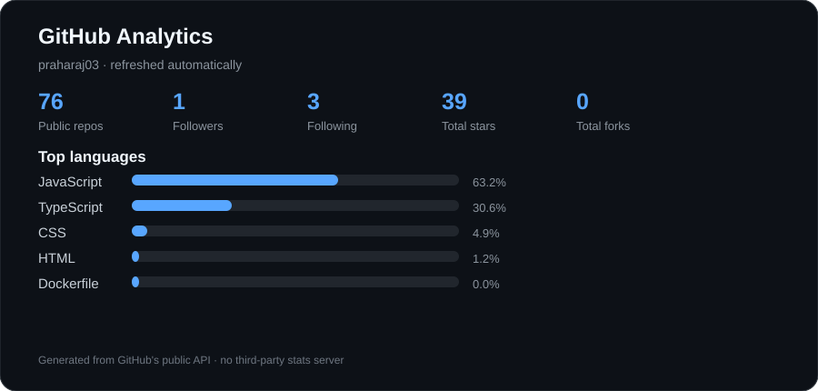

## About

I'm a Computer Science and Engineering student interested in building useful software, full-stack web development, backend systems, and problem-solving with Java.

- **Currently focused on:** Java, data structures and algorithms, and full-stack development
- **Building with:** React, Next.js, JavaScript, and backend APIs
- **Interested in:** Software engineering, practical AI applications, and system design fundamentals
- **Portfolio:** [praharajdev.vercel.app](https://praharajdev.vercel.app/)

## Featured Projects

| Project | Overview | Links |
|---|---|---|
| **Meta Mart** | Full-stack e-commerce application with product discovery, wishlist, cart, checkout, order tracking, authentication, and admin features. | [Live demo](https://meta-mart-sable.vercel.app/) · [Source code](https://github.com/praharaj03/Meta-Mart) |
| **PDrive** | Web-based drive project focused on file management and a clean web experience. | [Live demo](https://pdrive-six.vercel.app/) |
| **DSA Tracker** | A web-based tracker for organizing and monitoring data-structures-and-algorithms practice. | [Live demo](https://praharaj-sheet.vercel.app/) |
| **Appwrite Keeper** | A project exploring application development with Appwrite. | [Repository](https://github.com/praharaj03/appwrite-keeper) |

## Technical Skills

**Languages**  
Java · JavaScript · C · HTML · CSS

**Frontend**  
React · Next.js · Tailwind CSS · Responsive UI

**Backend and data**  
Node.js · Express.js · REST APIs · MongoDB · MySQL · Appwrite

**Tools and platforms**  
Git · GitHub · Vercel · Clerk · Stripe

## GitHub Activity

## Contact

I'm interested in connecting with developers, learning from real-world projects, and exploring software engineering opportunities.

- **Portfolio:** https://praharajdev.vercel.app/
- **LinkedIn:** https://www.linkedin.com/in/praharajabhisek
- **Email:** abhisekpraharaj246@gmail.com

*Build thoughtfully. Learn continuously.*

